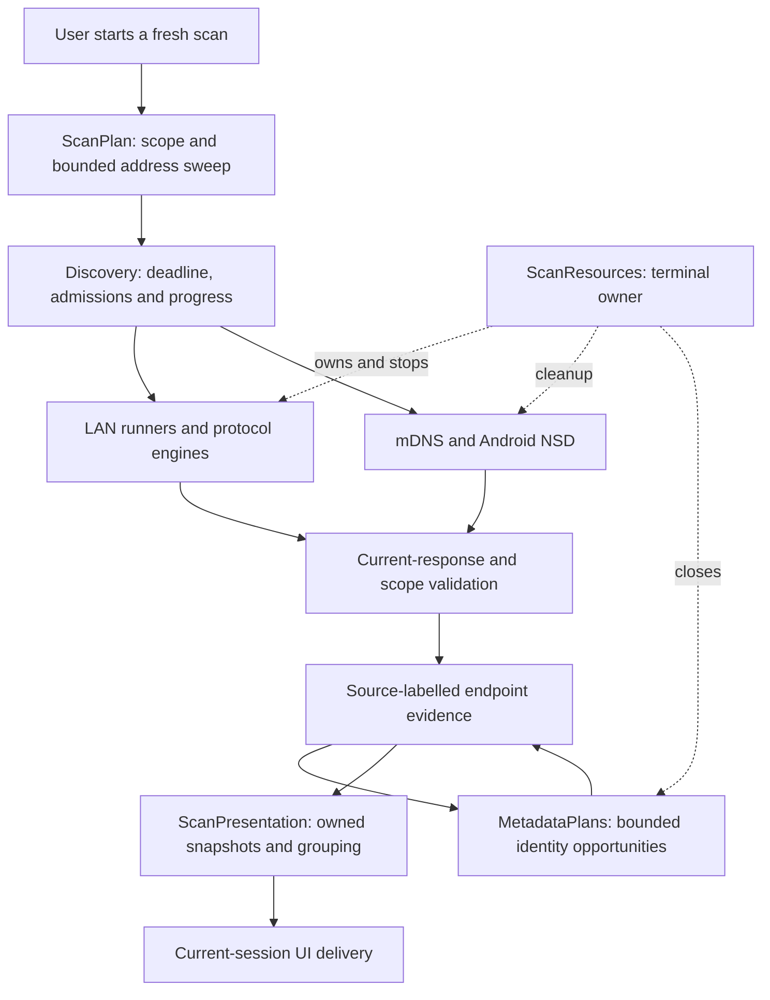

# Scan ownership and evidence flow

Included in Network Lens 0.3.20. See [release verification](VERIFICATION-0.3.20.md)
for the exact artifacts, completed checks and remaining physical-test limits.

- `ScanPlan` validates scope before allocating addresses. Automatic networks
  above 1,024 hosts retain their actual scope and run service discovery without
  a sweep. The omitted sweep remains incomplete in method health and explicit
  in scope text. Custom oversized/out-of-network ranges remain errors. There is
  no silent /24 substitution.
- `Discovery` retains authority over presence, scope, endpoint mutation and final
  publication. Extraction is incremental: mDNS/NSD, SADP, WS-Discovery and several
  LAN transports still live there; this is not a complete orchestrator rewrite.
- `LanProtocolRunners` contains Android transport adapters for SSDP, TP-Link,
  Omada and PlayStation. Their channel engines, including `SsdpDiscovery`, run
  independently of Android. Parsed replies still pass coordinator admission.
- `ScanResources` owns sockets, multicast-lock leases, protocol threads, executor shutdown, NSD cleanup
  and metadata-plan closure. Closing is terminal and idempotent. Late resource
  registration closes immediately instead of leaking a socket. Protocol thread
  joins share a bounded budget. The coordinator joins its children; the shared,
  bounded NSD handle-acquisition daemon remains process-scoped.
- `MetadataPlans` owns atomic admission and alternate-target scheduling. Closing
  cannot be reversed by a late advertisement. Original deadlines, two-target
  limits, endpoint fairness and transport-security separation remain intact.
- `ScanPresentation` retains owned endpoint copies and grouping. Consumers get
  detached copies. Operation/generation/terminal/sequence fences still reject
  stale delivery; the Activity filters again against the current network scope.

## Presence and cancellation

Cached/native advertisements remain candidates, never current identity. Complete
same-peer wire associations are required to use service identity; expiry, goodbye
and replacement rules remain in `MdnsAssembly` and `NativeServiceEvidence`.
Current validated protocol replies, correlated echo responses or two confirmed
TCP connections establish presence. Refusal, router names, previous results or a
catalogue match alone cannot establish it.

Foreground loss, cancellation and network replacement stop admissions before
cleanup. Late callbacks cannot reopen a session or import a prior IP occupant.
Each new scan has new admissions, metadata plans and evidence.

Startup and cancellation share a short lifecycle lock: a stopped scan cannot
re-enable admissions after network validation. Native discovery also checks the
terminal owner before startup. A multicast lock acquired during cancellation is
released when its lease registration is rejected. Lease release is synchronized
and idempotent across native cleanup and terminal resource cleanup; final native
cleanup remains a fallback and reports failures.

## Checks

Host `ScanLifecycleTest` exercises scope limits, registration/cancellation races,
late startup, failing closes, bounded joins, metadata closure and SSDP retries,
deduplication, scope and deadlines. Emulator `scan-ownership` exercises actual
registry integration, late vendor replies, withdrawn scope and snapshot isolation.
It also pauses the actual scan during startup, cancels, then resumes it to verify
that neither multicast reception nor native discovery starts. Separate emulator
checks acquire and release Android's actual multicast lock and reject stale
native startup after Stop. A host latch test covers cancellation between lease
acquisition and registration.
Existing lifecycle, metadata and coalescing suites cover surrounding behaviour.

See [recognition and performance baselines](RECOGNITION-BASELINE.md) for the
separate physical compatibility boundary.
