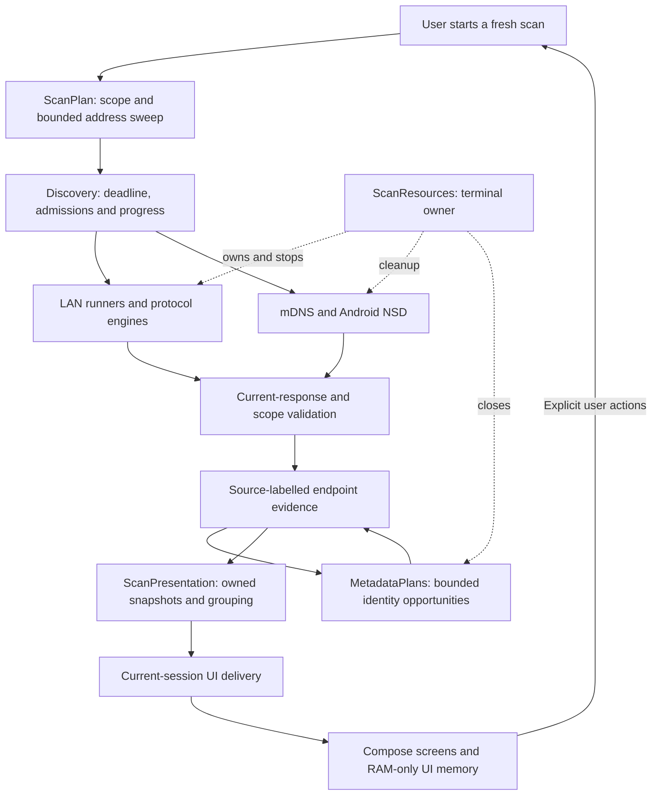

# Scan ownership and evidence flow

See [current release verification](../VERIFICATION-0.3.40.md) for exact artifact checks and physical-test limits.

- `ScanPlan` validates scope before allocating addresses. Automatic networks
  above 1,024 hosts retain their actual scope and run service discovery without
  a sweep. The omitted sweep remains incomplete in method health and explicit
  in scope text. Custom oversized/out-of-network ranges remain errors. There is
  no silent /24 substitution.
- `Discovery` retains authority over presence, scope, endpoint mutation and final
  publication. Extraction is incremental: mDNS/NSD, SADP, WS-Discovery and several
  LAN transports still live there; this is not a complete orchestrator rewrite.
- `LanProtocolRunners` contains Android transport adapters for SSDP, TP-Link,
  Omada and PlayStation. Their channel engines, including `SsdpDiscovery`, run
  independently of Android. Parsed replies still pass coordinator admission.
- `ScanResources` owns sockets, multicast-lock leases, protocol threads, executor shutdown, NSD cleanup
  and metadata-plan closure. Closing is terminal and idempotent. Late resource
  registration closes immediately instead of leaking a socket and raises a
  cancellation signal. The enrichment worker boundary consumes that terminal
  signal so a registration race cannot become an uncaught worker exception.
  Protocol thread
  joins share a bounded budget. The coordinator joins its children; the shared,
  bounded NSD handle-acquisition daemon remains process-scoped.
- `MetadataPlans` owns atomic admission and alternate-target scheduling. Closing
  cannot be reversed by a late advertisement. Original deadlines, two-target
  limits, endpoint fairness and transport-security separation remain intact.
- `ScanPresentation` retains owned endpoint copies and grouping. Consumers get
  detached copies. Operation/generation/terminal/sequence fences still reject
  stale delivery; the Activity filters again against the current network scope.
- The interface uses Compose with a lazy device list and dedicated
  list/detail/settings/dialog components. It renders current-session snapshots;
  only explicit actions reach scanning, updates and export handlers. Layout,
  filtering and disclosure do not supply identity or presence. UI choices and
  scroll offsets remain process-local. See [interface migration](INTERFACE.md).

## Presence and cancellation

Cached/native advertisements remain candidates, never current identity. Complete
same-peer wire associations are required to use service identity; expiry, goodbye
and replacement rules remain in `MdnsAssembly` and `NativeServiceEvidence`.
Current validated protocol replies, correlated echo responses or two confirmed
TCP connections establish presence. Refusal, router names, previous results or a
catalogue match alone cannot establish it.

The in-memory troubleshooting report separately retains up to 128 TCP presence
checks that completed at least one connection. It includes both connection
outcomes/timings and whether the address ultimately entered the inventory.
Failed reconfirmations take priority over confirmed checks at capacity; omitted
records are counted. These diagnostic targets never create devices or enter the
counts-only recognition report. The normal names/address redaction also covers
targets absent from the inventory. Cancellation seals the journal; a fresh scan
or changed scope does not inherit it.

Apple model lookups retain each transport attempt's request/stage, verified-service
state, received-byte count and actual timing limits. EOF, timeout and socket-reported
reset are distinct fixed diagnostic labels. Unrecognized socket errors remain
unspecified; exception messages are never exported. These diagnostics do not change
timeouts, retries, presence admission or recognition, and do not infer why a peer
closed its connection.

The initial address pass uses two 200ms ICMP attempts separated by 120ms.
Unanswered-address recovery uses two 600ms attempts with the same gap, allowing
a matching delayed reply for up to 1320ms on that probe's socket. Identifier,
sequence and nonce validation still apply. Recovery stays inside the existing
scan deadline and cancellation closes outstanding work.

Foreground loss, cancellation and network replacement stop admissions before
cleanup. Late callbacks cannot reopen a session or import a prior IP occupant.
Each new scan has new admissions, metadata plans and evidence.

Startup and cancellation share a short lifecycle lock: a stopped scan cannot
re-enable admissions after network validation. Native discovery also checks the
terminal owner before startup. A multicast lock acquired during cancellation is
released when its lease registration is rejected. Lease release is synchronized
and idempotent across native cleanup and terminal resource cleanup; final native
cleanup remains a fallback and reports failures.

## Checks

Host `ScanLifecycleTest` exercises scope limits, registration/cancellation races,
late startup, failing closes, bounded joins, metadata closure and SSDP retries,
deduplication, scope and deadlines. Emulator `scan-ownership` exercises actual
registry integration, late vendor replies, withdrawn scope and snapshot isolation.
It also pauses the actual scan during startup, cancels, then resumes it to verify
that neither multicast reception nor native discovery starts. Separate emulator
checks acquire and release Android's actual multicast lock and reject stale
native startup after Stop. A host latch test covers cancellation between lease
acquisition and registration.
Existing lifecycle, metadata and coalescing suites cover surrounding behaviour.

See [recognition and performance baselines](RECOGNITION-BASELINE.md) for the
separate physical compatibility boundary.

### Address-sweep allowance (0.3.29)

The normal scan budget remains 55 seconds. Each additional block of up to 256 hosts above 254 adds 15 seconds, up to 100 seconds for the supported 1,022-host /22. Service-only scans retain 55 seconds. Scope, presence evidence and concurrency limits are unchanged.

The initial sweep reserves the final 10 seconds for service/detail settlement. Expiring an address-check batch cancels its pending jobs and records a truncated method instead of throwing out of the coordinator and immediately closing unrelated readers. Unchecked addresses remain reported as unchecked; this is not a claim of complete discovery.

## Additional TCP reachability

The initial IPv4 sweep retains its eight common ports. Unanswered-address recovery and unidentified current responders can receive one additional pass over TCP 8012, 10101 and 11095. Admission is bounded to 1,024 addresses per scan; each pass has a 1,800 ms ceiling inside the original scan deadline, with at most two 160 ms connects per port and the existing cancellable 200 ms reconfirmation gap. The normal /24 deadline stays 55 seconds. Cancellation or expiry cannot admit a late connection.

These ports have been observed on tested Nest cameras in [UCL's published measurements, Table 3](https://discovery.ucl.ac.uk/id/eprint/10180273/1/Mandalari_Who%20Let%20the%20Smart%20Toaster%20Hack%20the%20House.pdf). They are also used by other products. They contribute only current reachability and observed ports, never a camera, manufacturer, model or grouping assertion. No Weave messages, credentials, pairing or device-control requests are sent.

Fixed per-port method counters distinguish failures and incomplete work. Current devices retain per-port outcomes in their diagnostic journals. The bounded TCP presence journal retains checks with at least one successful connection, including failed reconfirmation; addresses with no successful connection are represented by aggregate method counts only. Reports retain their existing names/addresses opt-in and omit arbitrary exception text.
